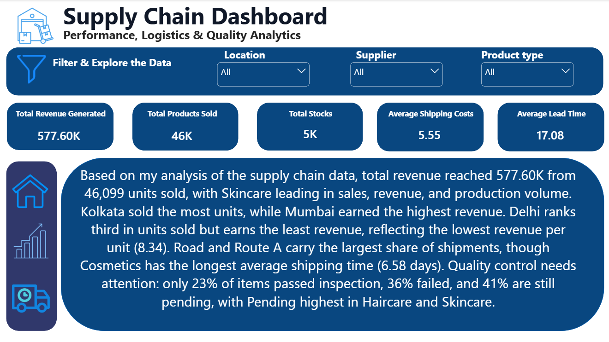
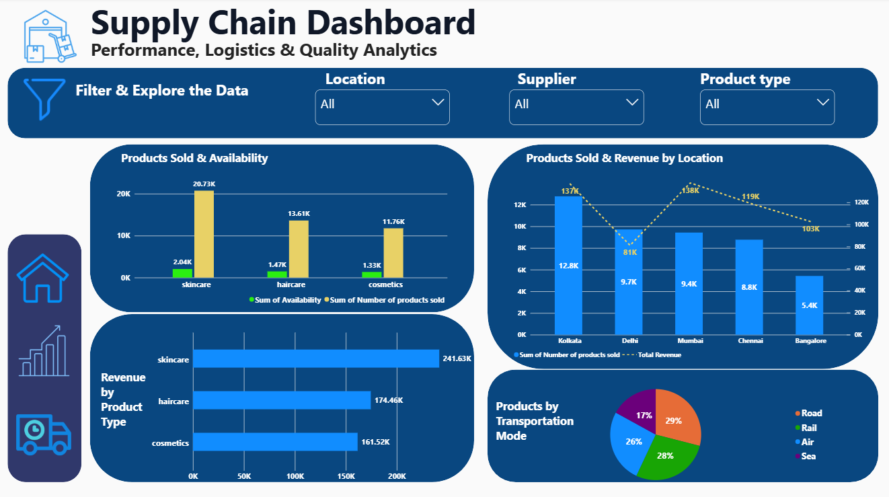
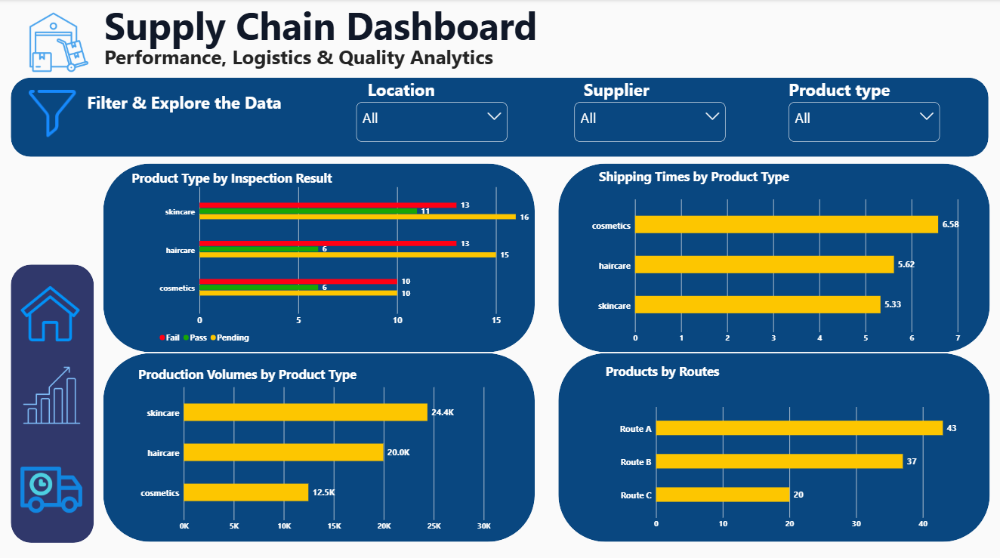

# Supply Chain Dashboard (Power BI)

An interactive Power BI dashboard analyzing sales, logistics, and quality performance for a beauty and personal care supply chain.

## Overview

The dashboard answers three questions:

1. How much are we selling, and where does the revenue come from?
2. How do products move (transport modes, routes, shipping times)?
3. How reliable is quality (inspection results, production volumes)?

## Dataset

- **File:** `data/supply_chain_data.csv`
- **Size:** 100 rows (one per SKU) and 24 columns, with no missing values or duplicates
- **Product types:** skincare, haircare, cosmetics
- **Locations:** Mumbai, Delhi, Kolkata, Chennai, Bangalore
- **Suppliers:** 5
- **Transportation modes:** Road, Rail, Air, Sea
- **Routes:** Route A, B, C

## KPIs

| KPI | Value |
|---|---|
| Total Revenue Generated | 577,604.82 |
| Total Products Sold | 46,099 |
| Total Stocks | 4,777 |
| Average Shipping Costs | 5.55 |
| Average Lead Time | 17.08 days |

> The dataset has two similar columns, `Lead times` (average 15.96) and `Lead time` (average 17.08). This report uses `Lead time`.

## Dashboard Pages

### Page 1: Overall
KPI cards and a summary report.

### Page 2: Sales & Distribution
- Products sold and availability by product type
- Products sold and revenue by location
- Products by transportation mode
- Revenue by product type

### Page 3: Operations & Quality
- Product type by inspection result
- Shipping times by product type
- Production volumes by product type
- Products by routes

Every page has slicers for **Location**, **Supplier**, and **Product type**.

## Dashboard Summary

> Based on my analysis of the supply chain data, total revenue reached 577.60K from 46,099 units sold, with Skincare leading in sales, revenue, and production volume. Kolkata sold the most units, while Mumbai earned the highest revenue. Delhi ranks third in units sold but earns the least revenue, reflecting the lowest revenue per unit (8.34). Road and Route A carry the largest share of shipments, though Cosmetics has the longest average shipping time (6.58 days). Quality control needs attention: only 23% of items passed inspection, 36% failed, and 41% are still pending, with Pending highest in Haircare and Skincare.

## Key Insights

**Sales and revenue**
- **Skincare leads.** It generates 241,628 in revenue (about 42% of the total) and sells 20,731 units, the most of any product type. Haircare follows with 174,455, then cosmetics with 161,521.
- **Kolkata sells the most units** (12,770), but **Mumbai earns the most revenue** (137,755), by a small margin over Kolkata (137,078).
- **Delhi has the lowest revenue** (81,028) despite being third in units sold (9,715). Its revenue per unit is about 8.34, the lowest of all locations, while Bangalore's is about 18.93.

**Logistics**
- Road (29 products), Rail (28), and Air (26) are used almost equally. Sea is used the least (17 products) and generates the lowest revenue (97,564).
- Sea is the cheapest to ship on average (4.97) but the slowest (7.12 days). Air is the most expensive (6.02), and Road is the fastest (4.72 days).
- Route A carries the most products (43, the largest share) and the most revenue (253,199). Route C carries the fewest (20) and has the highest average shipping cost (5.90).
- Cosmetics has the longest average shipping time (6.58 days), compared with 5.62 for haircare and 5.33 for skincare.

**Quality**
- Only **23 of 100 products passed inspection**. 41 are still pending and 36 failed.
- Fail and Pending outnumber Pass in every product type. Skincare has the best pass share (28%) and haircare the weakest (18%).
- Pending is highest in haircare (44%) and skincare (40%). Fail is highest in haircare and cosmetics (38% each).
- Skincare also has the highest production volume (24,366), followed by haircare (19,957) and cosmetics (12,461).

## Recommendations

1. **Invest in skincare**, which is the main driver of both sales and revenue.
2. **Review pricing in Delhi.** High volume but low revenue per unit suggests discounting or a low-priced product mix.
3. **Reduce pending inspections** and investigate the failure causes, since only a quarter of products have passed.
4. **Review Route C**, which has the lowest volume and the highest shipping cost.
5. **Shift time-sensitive cosmetics shipments to faster modes** (Road or Air), since cosmetics has the longest shipping time.

## Tools

- Power BI Desktop
- DAX (measures)
- Power Query (data typing and cleaning)

## DAX Measures

```DAX
Total Revenue = SUM(supply_chain_data[Revenue generated])
Total Products Sold = SUM(supply_chain_data[Number of products sold])
Total Stocks = SUM(supply_chain_data[Stock levels])
Avg Shipping Costs = AVERAGE(supply_chain_data[Shipping costs])
Avg Lead Time = AVERAGE(supply_chain_data[Lead time])
```

## Screenshots




## Repository Structure

```
supply-chain-dashboard/
├── README.md
├── data/
│   └── supply_chain_data.csv
├── dashboard/
│   └── Supply_Chain_Dashboard.pbix
├── images/
└── report/
```

## Author

**Hussien Ghoniem**, Data Analyst
[LinkedIn](https://www.linkedin.com/in/hussien-ghoniem-279a24441)
